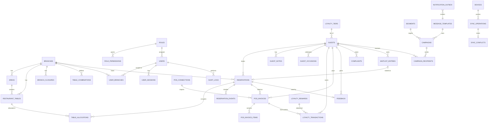

# Sofia's Resto-Lounge — Platform Architecture

> Restaurant Operating & Guest Intelligence Platform
> Internal technical name: **Sofia Restaurant Management Platform** · User-facing name: **Sofia's Resto-Lounge**

This document is the Phase 1 deliverable required before production code (§91 of the master prompt).
It covers, in order:

1. [Complete architecture](#1-complete-architecture)
2. [Technology selection](#2-technology-selection)
3. [Justification](#3-justification)
4. [Database ERD](#4-database-erd)
5. [Database tables](#5-database-tables)
6. [Relationships](#6-relationships)
7. [API endpoints](#7-api-endpoints)
8. [Authentication architecture](#8-authentication-architecture)
9. [RBAC matrix](#9-rbac-matrix)
10. [Offline architecture](#10-offline-architecture)
11. [Sync architecture](#11-sync-architecture)
12. [Conflict resolution strategy](#12-conflict-resolution-strategy)
13. [Update architecture](#13-update-architecture)
14. [Backup architecture](#14-backup-architecture)
15. [Deployment architecture](#15-deployment-architecture)
16. [Security architecture](#16-security-architecture)
17. [Folder structure](#17-folder-structure)
18. [Development roadmap](#18-development-roadmap)

---

## 1. Complete architecture

```
                         INTERNET
                            │
                            ▼
              HTTPS (Caddy reverse proxy, auto-TLS)
              https://sofia.example.com   http://SERVER-IP
                            │
          ┌─────────────────┴──────────────────┐
          │      Sofia API process (Fastify)    │  role=api
          │  /api/v1/*  /health  static PWA      │
          │  SSE live events  OpenAPI docs       │
          └───────┬───────────────────┬─────────┘
                  │                   │ pg_notify / LISTEN
                  ▼                   ▼
          ┌──────────────┐   ┌──────────────────────────────┐
          │ PostgreSQL 16│◄──│ Sofia Worker (role=worker)    │
          │ (private,    │   │  notifications outbox, POS     │
          │  localhost / │   │  polling, reminders, no-shows, │
          │  internal    │   │  campaigns, backups, retention │
          │  network)    │   └──────────────────────────────┘
          │              │   ┌──────────────────────────────┐
          │              │◄──│ Sofia Updater (role=updater)  │
          └──────────────┘   │  download → verify → backup →  │
                             │  migrate → switch → restart →  │
                             │  health-check → rollback       │
                             └──────────────────────────────┘

  BROWSER (PC / laptop / iPhone / Android / tablet) — installable PWA
  ┌──────────────────────────────────────────────────────────────────┐
  │ React UI ──► Repository layer ──► IndexedDB (Dexie)               │
  │                    │                 guests · reservations ·      │
  │                    │                 tables · waitlist · outbox   │
  │                    ▼                                               │
  │             Sofia Sync Engine ── push /sync/push ─┐               │
  │             (connectivity probe,  pull /sync/pull ─┤──► API        │
  │              retry, conflicts)    SSE /events ─────┘               │
  │ Service Worker: precached app shell, versioned assets, update UX  │
  └──────────────────────────────────────────────────────────────────┘
```

### Runtime roles

One codebase (`apps/server`) runs in four roles, so the restaurant installs one package:

| Role      | Responsibility | Restart impact |
|-----------|----------------|----------------|
| `api`     | REST API, auth, static PWA hosting, SSE live events, public booking API, health | Clients switch to offline mode and queue writes |
| `worker`  | Notification outbox dispatch, POS polling, reminders, auto no-show, waitlist expiry, campaign sends, scheduled backups, retention jobs | Jobs resume from durable tables |
| `updater` | Executes update jobs (separate process so it can restart the others) | None for guests |
| `cli`     | `migrate`, `backup`, `restore`, `user reset-password`, `export`, `health` — used by installer and Server Manager | n/a |

All long-running roles are started by the **Sofia launcher** (`deploy/runtime/launcher.mjs`), which reads `current.json`
to decide which release directory to run and restarts the role when it exits. That gives one uniform restart
mechanism for Windows services, systemd and Docker.

### Local-first principle (§74)

A browser cannot write to PostgreSQL while the server is powered off. Therefore **every staff write goes to IndexedDB
first and is appended to a durable outbox**. When the server is reachable the outbox is flushed immediately (online
mode feels identical to a normal app); when it is not, operations accumulate and are pushed automatically when the
server returns. PostgreSQL remains the single source of truth: the server validates every operation, may reject it
or raise a conflict, and the client rebases its local view on the server's answer.

---

## 2. Technology selection

| Layer | Choice |
|-------|--------|
| Language | TypeScript 5.9 everywhere (strict) |
| Frontend | React 19, Vite 7, React Router 7, TanStack Query 5, i18next (ar/en, RTL/LTR) |
| PWA | vite-plugin-pwa (Workbox), prompt-to-update flow, versioned precache |
| Offline DB | IndexedDB via Dexie 4 (+ dexie-react-hooks live queries) |
| Backend | Node.js 22 LTS, Fastify 5, Zod 4 validation shared with frontend |
| ORM | Drizzle ORM 0.45 (node-postgres driver) |
| Migrations | Hand-written, numbered SQL files + Sofia migration runner (checksums, lock, history) |
| Database | PostgreSQL 16 (extensions: `pgcrypto`, `citext`, `pg_trgm`, `btree_gist`) |
| Live updates | Server-Sent Events + PostgreSQL `LISTEN/NOTIFY` |
| Background jobs | PostgreSQL-backed queues (`FOR UPDATE SKIP LOCKED`) — no Redis |
| Password hashing | scrypt (Node built-in, OWASP parameters N=2¹⁶ r=8 p=2) |
| MFA | TOTP (RFC 6238) + one-time recovery codes |
| Reports | CSV, XLSX (ExcelJS), JSON; PDF via branded print layout (browser engine, correct Arabic shaping) |
| Updates | Ed25519-signed release manifests + SHA-256 package checksums |
| Reverse proxy | Caddy 2 (automatic HTTPS) |
| Packaging | Docker / Docker Compose (Linux/cloud), PowerShell installer + WinSW services (Windows PC/laptop) |
| Tests | Vitest (unit + integration on a real PostgreSQL), Playwright (browser e2e incl. offline scenario) |

---

## 3. Justification

**Fastify over NestJS.** The master prompt allows "NestJS or equivalent enterprise architecture". Fastify gives the same
modular structure (one plugin per domain module, a service layer, guards implemented as route hooks) with less runtime
overhead and *no decorator-metadata build step*. That matters here because the server is shipped as a single bundled
JavaScript file inside signed update packages and must run on a Windows laptop without a compiler toolchain. Route
definitions go through one `defineRoute()` helper that enforces authentication, RBAC permission, Zod validation and
OpenAPI documentation in a single place, so no endpoint can forget authorization.

**Drizzle ORM (selected) over Prisma/TypeORM.**
- *SQL-first*: Drizzle does not hide SQL, so PostgreSQL-specific integrity features the platform depends on —
  exclusion constraints (no double booking), `tstzrange`, partial indexes, trigram search, advisory locks — are used
  directly and stay visible in code review.
- *No query-engine binary*: Prisma ships a platform-specific engine, which complicates one-package updates across
  Windows/Linux. Drizzle is plain TypeScript and bundles cleanly.
- *Migrations are plain SQL*: every schema change is a reviewable `NNN_name.sql` file executed by our runner inside
  a transaction with checksum verification, which is exactly what the safe-update process (§23) requires.
  The Drizzle table definitions are kept in sync with the SQL and a test introspects the live database to detect drift.

**PostgreSQL-backed jobs instead of Redis.** A restaurant laptop server should have as few moving parts as possible.
Outbox tables with `SKIP LOCKED` give durable, transactional job queues (a notification is enqueued in the same
transaction as the reservation that triggers it), survive restarts, and are included in backups.

**SSE instead of WebSocket.** Live updates are server→client only (table status, new reservations, conflicts,
notifications). SSE works through every proxy, reconnects automatically, and carries cookies for authentication.
Client→server writes go through the sync outbox, which must work offline anyway.

**scrypt instead of argon2 native bindings.** scrypt is OWASP-approved, built into Node, and needs no native
compilation — critical for a portable, signed update package.

**Caddy instead of Nginx.** Equivalent reverse proxy, but obtains and renews TLS certificates automatically, which a
restaurant without an IT department needs. Available as a single Windows binary.

---

## 4. Database ERD



## 5. Database tables

All operational tables use **UUID primary keys** (UUIDv7 generated client-side for offline creation, so ids never
collide and inserts stay index-friendly), `created_at`, `updated_at`, `created_by`, `updated_by`, `deleted_at`
(soft deletion), `version` (optimistic concurrency) and `sync_seq` (global change-feed position, set by trigger).

| Migration | Tables |
|-----------|--------|
| `001_initial` | `schema_migrations`, `branches`, `branch_closures`, `roles`, `role_permissions`, `users`, `user_branches`, `user_sessions`, `devices`, `app_settings`, `stored_files`, `audit_logs` (append-only, RLS), `system_events`, `in_app_notifications`, `in_app_notification_reads` + sync triggers and sequence |
| `002_guest_crm` | `guests`, `guest_notes`, `guest_occasions` + trigram/phone/email indexes, `refresh_guest_stats()` |
| `003_reservations` | `areas`, `restaurant_tables`, `table_combinations`, `reservations`, `table_allocations` (**EXCLUDE USING gist** — no double booking), `reservation_events`, `waitlist_entries` |
| `004_loyalty` | `loyalty_tiers`, `loyalty_rules`, `loyalty_rewards`, `loyalty_transactions` |
| `005_pos_integration` | `pos_connections`, `pos_invoices`, `pos_invoice_items`, `pos_sync_runs` |
| `006_marketing` | `message_templates`, `notification_outbox`, `segments`, `campaigns`, `campaign_recipients` |
| `007_feedback` | `feedback`, `complaints` |
| `008_operations` | `sync_operations`, `sync_conflicts`, `backups`, `system_updates`, `saved_reports`, `maintenance_state` |

Key integrity rules enforced **inside PostgreSQL** (not only in application code):

- `table_allocations`: `EXCLUDE USING gist (table_id WITH =, period WITH &&) WHERE (active)` — two active
  allocations for the same table can never overlap, even under concurrent requests from different devices (§81).
- `reservations.party_size BETWEEN 1 AND 500`, `end_at > start_at`, status enum.
- Foreign keys everywhere, `ON DELETE RESTRICT` for business entities (soft deletion is used instead).
- `audit_logs`: row-level security policies permit `INSERT`/`SELECT` only; runtime role has no `UPDATE`/`DELETE` grant.
- `sync_operations.id` is the client operation UUID → an operation can be applied at most once (idempotency).
- `pos_invoices (connection_id, external_id)` unique → POS imports are idempotent.

## 6. Relationships

The guest is the central entity (§94):

```
GUEST ─┬─ RESERVATION ── TABLE_ALLOCATION ── TABLE ── AREA ── BRANCH
       │        └── RESERVATION_EVENTS (timeline)   └── POS_INVOICE ── ITEMS
       ├─ GUEST_NOTES / OCCASIONS / PREFERENCES / ALLERGIES
       ├─ LOYALTY_TRANSACTIONS ── TIER / REWARD
       ├─ FEEDBACK ── COMPLAINT
       ├─ WAITLIST_ENTRY
       └─ CAMPAIGN_RECIPIENT ── CAMPAIGN ── SEGMENT
```

- A **reservation** belongs to one branch and (optionally) one guest; it occupies 0..n tables through
  `table_allocations` (table combinations = several allocation rows with the same period).
- A **walk-in** is a reservation with `source = 'walk_in'` created directly in `seated` state, so table occupancy logic
  is identical for both.
- A **POS invoice** is matched to a reservation (branch + table + time window, or explicit code/phone/loyalty number on
  the bill) and therefore to a guest; guest spending aggregates are recalculated by `refresh_guest_stats()`.
- **Guest merge** re-points every child row to the surviving guest and soft-deletes the merged one with
  `merged_into_id`, keeping history intact.

## 7. API endpoints

Base path `/api/v1` (versioned). Machine-readable OpenAPI: `/api/v1/openapi.json`, interactive docs `/api/v1/docs`.

| Module | Endpoints |
|--------|-----------|
| Health | `GET /health`, `GET /health/live`, `GET /health/ready` |
| Setup | `GET /setup/status`, `POST /setup/complete` (requires installer setup token) |
| Auth | `POST /auth/login`, `POST /auth/mfa/verify`, `POST /auth/refresh`, `POST /auth/logout`, `GET /auth/me`, `POST /auth/password`, `POST /auth/mfa/setup`, `POST /auth/mfa/enable`, `POST /auth/mfa/disable`, `GET /auth/sessions`, `DELETE /auth/sessions/:id` |
| Users / Roles | `GET/POST /users`, `GET/PATCH /users/:id`, `POST /users/:id/reset-password`, `GET /roles`, `PUT /roles/:id/permissions` |
| Branches | `GET/POST /branches`, `GET/PATCH /branches/:id`, `GET/POST /branches/:id/closures`, `DELETE /branches/:id/closures/:closureId` |
| Areas / Tables | `GET/POST /areas`, `PATCH/DELETE /areas/:id`, `GET/POST /tables`, `PATCH/DELETE /tables/:id`, `PUT /tables/layout`, `POST /tables/:id/status`, `GET /tables/live`, `GET/POST /table-combinations`, `DELETE /table-combinations/:id` |
| Availability | `GET /availability/slots`, `GET /availability/tables` |
| Guests (CRM) | `GET/POST /guests`, `GET/PATCH/DELETE /guests/:id`, `GET /guests/:id/profile` (360°), `GET/POST /guests/:id/notes`, `GET/POST /guests/:id/occasions`, `DELETE /guests/:id/occasions/:oid`, `GET /guests/duplicates`, `GET /guests/duplicate-candidates`, `POST /guests/:id/merge`, `GET /guests/:id/export`, `POST /guests/:id/anonymize` |
| Reservations | `GET/POST /reservations`, `GET/PATCH /reservations/:id`, `POST /reservations/:id/{confirm,check-in,seat,start-dining,complete,cancel,no-show,reschedule,assign-tables}`, `GET /reservations/:id/events` |
| Walk-ins / Waitlist | `POST /walk-ins`, `GET/POST /waitlist`, `PATCH /waitlist/:id`, `POST /waitlist/:id/{notify,seat,cancel}`, `GET /waitlist/suggestions` |
| Loyalty | `GET/PUT /loyalty/config`, `GET /loyalty/guests/:guestId`, `POST /loyalty/adjust`, `POST /loyalty/redeem` |
| Feedback / Complaints | `GET /feedback`, `GET/POST /complaints`, `PATCH /complaints/:id` |
| POS | `GET/POST /pos/connections`, `PATCH /pos/connections/:id`, `POST /pos/connections/:id/{test,sync,import}`, `POST /pos/webhook/:connectionId` (HMAC), `GET /pos/invoices`, `GET /pos/invoices/:id`, `POST /pos/invoices/:id/link` |
| Marketing | `GET/POST /segments`, `PATCH/DELETE /segments/:id`, `GET /segments/:id/preview`, `GET/POST /campaigns`, `PATCH /campaigns/:id`, `POST /campaigns/:id/{schedule,send,cancel}`, `GET /campaigns/:id/stats` |
| Notifications | `GET/PUT /notification-templates`, `GET /notifications/outbox`, `GET /inbox`, `POST /inbox/:id/read` |
| Analytics | `GET /analytics/host`, `GET /analytics/owner`, `GET /analytics/reservations`, `GET /analytics/guests`, `GET /analytics/tables` |
| Reports | `GET /reports/datasets`, `POST /reports/run`, `POST /reports/export`, `GET/POST /reports/saved`, `DELETE /reports/saved/:id` |
| Search | `GET /search?q=` |
| Sync | `GET /sync/ping`, `POST /sync/push`, `GET /sync/pull`, `GET /sync/status`, `GET /sync/conflicts`, `POST /sync/conflicts/:id/resolve` |
| Settings / Files | `GET /settings`, `PUT /settings/:key`, `POST /files`, `GET /files/:id` |
| Audit / Logs | `GET /audit`, `GET /system/logs` |
| System | `GET /system/status`, `POST /system/restart`, `GET/POST /backups`, `POST /backups/:id/{verify,restore}`, `GET /backups/:id/download`, `GET /updates/status`, `POST /updates/{check,download,install,rollback}`, `GET /updates/history` |
| Data ownership | `GET /export/full` (ZIP of CSV + JSON for every entity) |
| Live | `GET /events` (SSE) |
| Public | `GET /public/branding`, `GET /public/branches`, `GET /public/availability`, `POST /public/reservations`, `GET /public/reservations/:code`, `POST /public/reservations/:code/cancel`, `GET /public/reservations/:code/calendar.ics`, `GET/POST /public/feedback/:token`, `POST /public/opt-out` |
| Webhooks | `GET/POST /webhooks/whatsapp` (Meta signature verified) |

## 8. Authentication architecture

```
login(username, password) ──► scrypt verify (constant time) ──► MFA enabled? ──► TOTP verify
        │                                                                   │
        └── failures counted per account (lockout) + per IP (rate limit) ◄──┘
                                   │
                                   ▼
        access JWT (HS256, 15 min)  +  refresh token (256-bit random, 30 days, rotated, stored SHA-256 hashed)
        cookies: sofia_at / sofia_rt  HttpOnly · Secure · SameSite=Strict · Path-scoped
        CSRF:   sofia_csrf cookie (readable) must be echoed in X-CSRF-Token on every state-changing request
```

- Refresh-token **rotation with reuse detection**: presenting an already-rotated refresh token revokes the whole
  session family.
- Sessions are listed and revocable per user; password change revokes all other sessions.
- **Offline unlock**: after a successful online login the browser stores a PBKDF2-SHA-256 (310 000 iterations) verifier
  of the password in IndexedDB. When the server is unreachable, a user who has logged in on this device before can
  unlock the app with the same password for a limited grace period (default 72 h). Queued operations carry the user id;
  the server re-authorizes every operation when it is pushed.
- First administrator is created by the **first-run wizard**, protected by a one-time setup token printed by the
  installer. There are no built-in default credentials.

## 9. RBAC matrix

Permissions are fine-grained strings (`module.action`). Roles are stored in the database and editable by Super Admin;
the defaults below are seeded by migration. Branch scope: roles marked **All** see every branch; other users see only
branches assigned in `user_branches`.

Legend: ● full · ◐ read/limited · — none

| Permission group | Super Admin | Owner | Head Office | General Mgr | Branch Mgr | Resv. Mgr | Host | Reception | Waiter | Cashier | Marketing | CRM Mgr | Auditor | Read Only |
|---|---|---|---|---|---|---|---|---|---|---|---|---|---|---|
| Branch scope | All | All | All | Assigned | Assigned | Assigned | Assigned | Assigned | Assigned | Assigned | All | All | All | Assigned |
| Branches | ● | ● | ● | ◐ | ◐ | ◐ | ◐ | ◐ | ◐ | ◐ | ◐ | ◐ | ◐ | ◐ |
| Users & roles | ● | ● | ● | ● | ● | — | — | — | — | — | — | — | ◐ | — |
| Tables / floor plan | ● | ● | ● | ● | ● | ◐+status | ◐+status | ◐+status | ◐+status | ◐ | — | — | ◐ | ◐ |
| Reservations | ● | ● | ● | ● | ● | ● | ● | ● | ◐ | ◐ | ◐ | ◐ | ◐ | ◐ |
| Override hours/capacity | ● | ● | ● | ● | ● | ● | — | — | — | — | — | — | — | — |
| Check-in / seating | ● | ● | ● | ● | ● | ● | ● | ● | ● | — | — | — | — | — |
| Waitlist / walk-ins | ● | ● | ● | ● | ● | ● | ● | ● | ◐ | — | — | — | ◐ | ◐ |
| Guests (read/create/edit) | ● | ● | ● | ● | ● | ● | ● | ● | ◐ | ◐ | ◐ | ● | ◐ | ◐ |
| Guest VIP level | ● | ● | ● | ● | ● | ● | — | — | — | — | — | ● | — | — |
| Guest merge / delete / export | ● | ● | ● | ● | ● | — | — | — | — | — | — | ● | — | — |
| Loyalty adjust / configure | ● | ● | ● | ● | ● | — | — | — | — | redeem | — | ● | ◐ | ◐ |
| Marketing | ● | ● | ● | ● | ◐ | — | — | — | — | — | ● | ◐ | ◐ | — |
| Feedback / complaints | ● | ● | ● | ● | ● | ◐ | ◐ | ◐ | — | — | ◐ | ● | ◐ | ◐ |
| POS | ● | ● | ● | ● | ● | — | — | — | — | ◐ | — | — | ◐ | — |
| Owner analytics / revenue | ● | ● | ● | ● | ● | — | — | — | — | — | ● | ● | ● | — |
| Host dashboard | ● | ● | ● | ● | ● | ● | ● | ● | ● | ● | — | ● | ● | ● |
| Reports / export | ● | ● | ● | ● | ● | ◐ | — | — | — | — | ● | ● | ● | ◐ |
| Settings | ● | ● | ● | ● | ◐ | — | — | — | — | — | — | — | ◐ | — |
| Sync conflict review | ● | ● | ● | ● | ● | ● | — | — | — | — | — | — | — | — |
| Audit log | ● | ● | ● | ● | ● | — | — | — | — | — | — | — | ● | — |
| Backups / restore | ● | ● (backup) | — | ● (backup) | — | — | — | — | — | — | — | — | — | — |
| System updates / logs | ● | ● | ◐ logs | ◐ logs | — | — | — | — | — | — | — | — | ◐ logs | — |
| Full data export | ● | ● | ● | — | — | — | — | — | — | — | — | — | — | — |

The exact permission list per role lives in `packages/shared/src/permissions.ts` and is enforced by the server on every
route (`defineRoute({ permission })`) and mirrored in the UI to hide unavailable actions.

## 10. Offline architecture

**Local store** (IndexedDB, Dexie schema-versioned):

| Store | Contents | Written offline |
|-------|----------|-----------------|
| `guests`, `guestNotes` | CRM records (all active guests, paged download) | ✔ create / edit / notes |
| `reservations` | From *today − 30 days* onward for the user's branches | ✔ create / edit / check-in / seat / complete / cancel / no-show / walk-in |
| `waitlist` | Active entries | ✔ add / edit / seat / cancel |
| `tables`, `areas`, `branches`, `combinations` | Reference + manual table status | ✔ table status (cleaning/blocked/available) |
| `settings`, `session`, `meta` | Branding, reservation rules, cached user + permissions, sync cursors, device id | — |
| `outbox` | **Offline Sync Queue** | ✔ every mutation |
| `conflicts` | Server-reported conflicts for this device | — |

**Outbox record** (§12): `opId` (UUID), `seq` (local monotonic id), `entityType`, `entityId`, `op`
(`create`/`update`/`delete`/`action`), `action`, `payload`, `baseVersion`, `baseValues`, `clientTs`, `userId`,
`deviceId`, `branchId`, `status` (`pending`/`syncing`/`synced`/`failed`/`conflict`/`requires_review`), `attempts`,
`lastError`, `syncedAt`.

**Status indicator** (always visible, §60):

| State | Meaning |
|-------|---------|
| `ONLINE` ● Connected to Sofia Server | probe OK, outbox empty |
| `SYNCING` | outbox being pushed / changes being pulled |
| `OFFLINE` ● Offline Mode · N changes waiting | device has no network |
| `SERVER UNAVAILABLE` · N changes waiting | network OK, server not reachable |
| `ONLINE · Internet unavailable` | server reachable on LAN but server reports no internet (§73) |

Reservations created offline show **"Saved on this device — not yet confirmed by the central server"** until the
server accepts them.

## 11. Sync architecture

```
 UI write ─► IndexedDB (optimistic) ─► outbox (pending)
                                          │  trigger: write, online event, probe success, 15 s timer, SSE hint
                                          ▼
                              Sofia Sync Engine (client)
                     PUSH  POST /sync/push {deviceId, ops[≤100] in local order}
                                          │
                     server, per op, in its own transaction:
                       1. idempotency  — op id already in sync_operations → return stored result (no duplicate)
                       2. authorization — session user must hold the permission for this op (branch scoped)
                       3. validation   — Zod schema + business rules (hours, party size, table availability)
                       4. conflict detection — version / 3-way field merge / exclusion constraint
                       5. apply + audit log (actor, offline actor, device, IP) + reservation events
                       6. record sync_operations row (applied | conflict | rejected)
                                          │
                     response per op: applied (+ authoritative record) | duplicate | conflict (+ conflict id) | rejected
                                          ▼
                     client: replace local record with server record, mark op synced / conflict / failed
                     PULL  GET /sync/pull?cursor=<sync_seq>  → changed rows of all syncable entities since cursor
                     client rebases local records that still have pending ops (server row + pending changes)
```

- **Change feed**: every syncable row gets `sync_seq = nextval('sofia_sync_seq')` on insert/update via trigger. Writers
  take a shared advisory lock for the transaction; the pull handler briefly takes the exclusive lock to read a
  *high-water mark* that is guaranteed to have no in-flight lower sequence numbers, so pulls never skip a row committed
  late.
- **Ordering**: ops are pushed in local order; ops on the same entity after a conflicting op are still applied when they
  do not touch conflicting fields, otherwise they are marked `requires_review`.
- **Retries**: network failures → exponential backoff (2 s → 5 min), op stays `pending`. Server 5xx → `failed` with
  automatic retry. Validation rejection → `failed` with message (visible in Sync Dashboard, can be edited/retried or
  discarded by a manager).
- **Real-time**: SSE `/events` pushes `{type:'changes'}` hints; the client pulls immediately.

## 12. Conflict resolution strategy

| Data | Strategy |
|------|----------|
| Guest non-critical fields (notes, preferences, tags, allergies, dietary, address, preferred name, language) | **3-way merge**: server applies a field if the server value still equals the client's `baseValue`. Arrays (tags/allergies/dietary) merge as set add/remove. Free-text conflict → server value kept, client text preserved as a guest note "Offline edit (device X)" so nothing is lost. |
| Guest critical fields (phone, email, VIP level, marketing consent, birthday) | If changed on both sides → **conflict record** (status `open`), server value retained until a manager chooses *keep server / take client / custom*. |
| Reservation time, party size, tables, branch | **Strict**: if the server row changed since `baseVersion` on any of these → conflict. Otherwise re-validated against hours, capacity and the exclusion constraint. |
| Offline-created reservation that overlaps another table allocation | Reservation is **kept** (data is never lost) but saved **without** the conflicting table, `requires_review = true`, conflict record `reservation_overlap` + staff notification. |
| Status transitions (e.g. offline check-in vs. online cancellation) | Validated against the reservation state machine; impossible transition → conflict record. |
| Loyalty transactions | Append-only, idempotent by op id — never conflict. |
| Duplicate guests created offline on two devices | Both kept; `duplicate_guest` review item created; manager merges. |

Every resolution writes an audit-log entry (who, when, which value won).

## 13. Update architecture

```
 Trusted update feed (HTTPS) ── manifest.json (Ed25519-signed) ── sofia-X.Y.Z.tar.gz (SHA-256)
                │
   Settings → System → Updates (admin with system.update)
                │  Check ─► Download ─► Verify (signature + checksum) ─► Install
                ▼
   Updater process:
    1. pre-update database backup (pg_dump -Fc) — abort if it fails
    2. extract package to releases/X.Y.Z (staging; existing releases untouched)
    3. enable maintenance mode (API answers writes with 503 → clients queue offline)
    4. run versioned SQL migrations from the new release (transactional, checksummed)
    5. switch current.json → X.Y.Z (atomic rename)
    6. restart api + worker (Windows service / systemd / launcher signal)
    7. health check: /health must report version X.Y.Z and all checks OK within timeout
    8. success → disable maintenance, record history
       failure → switch back, restore pre-update backup if migrations ran, restart, health check, record rolled_back
```

- **Separation (§72)**: application code (`releases/<version>`), database migrations (`schema_migrations`), and
  configuration (`config/sofia.env`, `app_settings`) are updated by separate steps; user data and uploads are never in
  the release directory.
- **Expand/contract migrations**: releases only add schema in backward-compatible ways; destructive changes are marked
  `-- sofia:breaking` and the update center warns that rollback of such a release requires restoring the pre-update
  backup.
- **Client auto-update (§25)**: the service worker detects the new build, shows *"A new version of Sofia's
  Resto-Lounge is available — Update Now / Update Later"*, then activates and reloads; outdated precaches are deleted.
  The outbox in IndexedDB survives updates; the API rejects clients older than the minimum sync protocol version with
  HTTP 426 so stale JavaScript can never corrupt data.
- Versioning: SemVer `MAJOR.MINOR.PATCH`; history kept in `system_updates`.

## 14. Backup architecture

```
 Worker scheduler (settings: daily at 03:30, every N hours, retention days / count)
   └─► pg_dump -Fc  ─► backups/sofia_<db>_<timestamp>_<kind>.dump (+ SHA-256)
         └─► verify: pg_restore --list (structure) and optional full restore into a scratch database
               └─► copy to external directory (USB / NAS / synced cloud folder) if configured
                     └─► retention pruning ─► backups table + system_events
 Failure ─► in-app notification to administrators + health check "backup" turns red
```

Kinds: `scheduled`, `manual`, `pre_update`, `pre_restore`. Restore (admin, typed confirmation): pre-restore backup →
maintenance mode → `pg_restore --clean --if-exists --single-transaction` → migrations → health check → exit maintenance.

## 15. Deployment architecture

| Option | Topology |
|--------|----------|
| **A. Dedicated Linux server / C. Cloud VM** | Docker Compose (`deploy/docker-compose.yml`): `postgres` (internal `backend` network only, no published port), `api`, `worker`, `updater` (same image, launcher roles), `caddy` (80/443, automatic HTTPS). Volumes: `pgdata`, `sofia` (releases, backups, uploads, config), `caddy_data`. |
| **B. Windows PC / laptop as restaurant server** | `deploy/windows/Install-Sofia.ps1`: PostgreSQL 16 service bound to localhost (port blocked in the firewall), Node.js 22, release in `C:\Sofia\releases\<v>` with `current.json`, WinSW services *SofiaAPI*, *SofiaWorker*, *SofiaUpdater* and *SofiaWeb* (Caddy) with automatic start, firewall opened for Private/Domain networks, **Sofia Server Manager** (Arabic/English) for status and control. |

All processes run through the same launcher (`deploy/runtime/launcher.mjs`), which starts the release named in
`current.json` and restarts it after an update; the updater therefore works identically on Windows, Linux and Docker.

Access and HTTPS: offline mode requires a secure origin, so staff devices use HTTPS — either Caddy's private
certificate authority on the restaurant network (`https://SERVER-IP`, CA installed once per device from
`http://SERVER-IP/sofia-ca.crt`) or a public domain with an automatic Let's Encrypt certificate. The public booking
page needs the public option. PostgreSQL is never reachable from outside. Details: `docs/OPERATIONS.md`.

## 16. Security architecture

| Concern | Control |
|---------|---------|
| Transport | HTTPS via Caddy (HSTS), secure cookies |
| Passwords | scrypt, per-user salt, policy (≥10 chars, not username), never logged or stored in plaintext |
| Sessions | short-lived JWT + rotating refresh tokens, revocation, idle timeout |
| MFA | TOTP, optional per user, enforceable for admin roles |
| Authorization | RBAC on every route + branch scoping in every query |
| CSRF | SameSite=Strict cookies + double-submit token header |
| XSS | React escaping, strict CSP via Helmet, no `dangerouslySetInnerHTML`, templates escaped for email HTML |
| SQL injection | Parameterized queries only (Drizzle / `pg` placeholders); report builder uses whitelisted columns |
| Rate limiting | global + strict on login/public booking/webhooks |
| Secrets at rest | AES-256-GCM for integration credentials and MFA secrets (`SOFIA_ENCRYPTION_KEY`) |
| Payments | No raw card data is ever stored or processed; deposits are recorded by staff (a provider-hosted checkout can be added later without touching card data) |
| Database | Not exposed publicly; separate roles: `sofia_owner` (migrations/backup) and `sofia_app` (runtime DML only, no DDL, append-only audit) |
| Audit | Append-only `audit_logs` with old/new values, user, device, IP |
| Updates | Ed25519 signature + SHA-256 verification, admin-only, never execute unverified packages |
| Webhooks | HMAC-SHA256 signature verification (POS, WhatsApp) |
| Privacy | consent per channel, opt-out links, data export, correction, anonymization, retention policy |

## 17. Folder structure

```
.
├── apps/
│   ├── server/                 Fastify API, worker, updater, CLI
│   │   ├── migrations/         001_initial.sql … versioned SQL
│   │   ├── src/
│   │   │   ├── main.ts         role dispatcher (api | worker | updater | cli)
│   │   │   ├── app.ts          Fastify app factory
│   │   │   ├── config.ts       env parsing
│   │   │   ├── db/             pool, drizzle schema, migration runner, sync locks
│   │   │   ├── lib/            errors, route helper (RBAC + OpenAPI), crypto, audit, events
│   │   │   ├── modules/        auth, users, branches, tables, guests, reservations, waitlist, loyalty,
│   │   │   │                   pos, marketing, notifications, feedback, analytics, reports, sync,
│   │   │   │                   settings, system (backups, updates, logs), public, search, export
│   │   │   ├── integrations/   pos/, messaging/ (whatsapp, email, sms), payment/
│   │   │   ├── worker/         schedulers and queue processors
│   │   │   └── updater/        update orchestration, service controllers
│   │   └── test/               integration tests against real PostgreSQL
│   └── web/                    React PWA (staff app + public booking page + widget)
│       └── src/
│           ├── app/            shell, routing, layout, status bar
│           ├── offline/        Dexie DB, outbox, sync engine, connectivity, rebase
│           ├── features/       dashboard, reservations, floor-plan, guests, waitlist, loyalty, marketing,
│           │                   feedback, reports, sync, settings, updates, setup
│           ├── booking/        public booking app + embeddable widget
│           ├── i18n/           ar.json, en.json
│           └── ui/             design system components, theme
├── packages/shared/            Zod schemas, enums, RBAC matrix, state machines, time utils, sync protocol
├── deploy/
│   ├── docker/                 Dockerfile, entrypoint, PostgreSQL init (runtime role)
│   ├── caddy/                  Caddyfile for Docker
│   ├── runtime/                launcher.mjs (process supervisor shared by all platforms)
│   ├── windows/                Install-Sofia.ps1, SofiaServerManager.ps1, Uninstall-Sofia.ps1, WinSW + Caddy
│   │                           templates, Inno Setup script
│   └── docker-compose.yml, generate-env.sh
├── scripts/                    release build + signing, update keys, Windows bundle, test database
├── e2e/                        Playwright end-to-end tests (offline → sync critical scenario)
├── brand/                      official logo (original + transparent variants + icons)
└── docs/                       architecture, operations, API, testing
```

## 18. Development roadmap

| Phase | Deliverable | Status |
|-------|-------------|--------|
| 1 | System architecture (this document) | Done |
| 2 | Database ERD | Done (§4) |
| 3 | PostgreSQL schema — versioned migrations | Done, tested |
| 4 | Backend/API (Fastify, OpenAPI) | Done, tested |
| 5 | Authentication / RBAC / MFA | Done, tested |
| 6 | Frontend / PWA shell, branding, i18n | Done, visually checked |
| 7 | Reservation engine (availability, exclusion constraint, state machine) | Done, tested |
| 8 | Guest 360° CRM (profile, history, duplicates, merge, privacy) | Done, tested |
| 9 | Floor plan (drag & drop, live status, combinations) | Done |
| 10 | Offline engine (IndexedDB, outbox, offline unlock) | Done, tested in Chromium |
| 11 | Synchronization (push/pull, conflicts, dashboard) | Done, tested |
| 12 | POS integration (REST pull, signed webhook, CSV import, matching) | Done; REST adapter needs a real POS to validate |
| 13 | Loyalty (tiers, rules, rewards, points ledger) | Done, tested |
| 14 | Marketing (segments, campaigns, consent, outbox) | Done; real WhatsApp/SMS/email need credentials |
| 15 | Analytics (host, owner, reservation, guest, table) | Done, tested |
| 16 | Backup (scheduled, verified, retention, restore) | Done, tested (incl. least-privilege restore) |
| 17 | Update Center (signed packages, migrations, rollback) | Done, tested |
| 18 | Security hardening | Done |
| 19 | Testing (unit, integration, sync, conflict, e2e offline, update) | Done — 69 tests + browser e2e |
| 20 | Deployment (Docker, Windows installer, Server Manager) | Written; Windows scripts not yet run on Windows, Docker image not yet built |

`docs/STATUS.md` lists, item by item, what is verified, what still has to be proven in a real environment, and what
is not implemented (online payment gateway, guest push notifications, server-side PDF).
